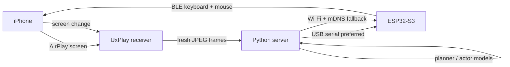

<style>
.post-content .esp32-shot-pair {
  display: grid;
  grid-template-columns: repeat(2, minmax(0, 1fr));
  gap: 18px;
  align-items: start;
  margin: 28px 0;
}

.post-content .esp32-shot-pair figure {
  margin: 0;
}

.post-content .esp32-shot-pair img {
  width: 100%;
  max-height: 620px;
  margin: 0;
  object-fit: contain;
}

.post-content .esp32-shot-pair figcaption {
  margin-top: 8px;
}

@media (max-width: 640px) {
  .post-content .esp32-shot-pair {
    grid-template-columns: 1fr;
  }
}
</style>

> A 3-minute video version is also available on WeChat Channels: https://weixin.qq.com/sph/AA6ejn5Zx9

Making an agent operate an iPhone is usually less a model problem than a hands problem. Android has ADB. Apple's usual route, WebDriverAgent, needs developer mode, Xcode signing, and certificate maintenance; free certificates expire after seven days, and the setup is awkward on a borrowed phone.

I took a different route. The ESP32-S3 acts only as a standard Bluetooth keyboard and mouse. AirPlay sends the screen to a computer, and a Python server watches the pointer, corrects its position, and then clicks. The phone does not need a jailbreak or a control app.

The code is at [hi-unc1e/esp32-iphone-agent](https://github.com/hi-unc1e/esp32-iphone-agent). The mainline is now computer control. The original standalone setup, where the board receives AirPlay itself and an iPhone app runs the agent, is still there.

## How it runs

To iOS, `iPhone Agent HID` is just another Bluetooth keyboard and mouse. With AssistiveTouch enabled, pointer movement becomes cursor movement, a click becomes a tap, and a drag becomes a swipe.



On the phone there are only two entry points: a keyboard and mouse in Bluetooth, and a mirroring target in Control Center. The screenshots below are from my iPhone's Chinese locale.

<div class="esp32-shot-pair">
  <figure>
    
    <figcaption>Pair <code>iPhone Agent HID</code> in Bluetooth.</figcaption>
  </figure>
  <figure>
    
    <figcaption>Send the screen to <code>iPhone Agent</code> from Control Center.</figcaption>
  </figure>
</div>

Three details decide whether the link stays usable.

The first is pointer drift. iOS mouse movement uses relative coordinates and adds acceleration. The firmware splits every movement into equal-length reports and sends one every 15 ms so BLE does not merge intermediate frames. The server fits the screen scale with a three-point calibration and periodically pulls the pointer back to the upper-left corner.

The second is seeing before clicking. Set the AssistiveTouch pointer to a small green ring, and the server finds it before every tap. If the error exceeds 0.8% of the screen distance, it corrects the position, up to three times. If the pointer still is not on target, it does not click.

The third is checking after the tap. A tap is not a success until the next frame arrives and the screen changes. Each action leaves a screenshot, coordinates, and timing, so a failed run can be traced back to the exact frame.

<figure>
  
  <figcaption>The App Store after the agent opened it. The green pointer is still on screen.</figcaption>
</figure>

This 7.6-second recording shows the pointer moving and the UI responding:

<video controls preload="metadata" playsinline style="width:100%;max-width:100%;height:auto;">
  <source src="/video/esp32-iphone-ble-hid-agent/demo.mp4" type="video/mp4">
  Your browser does not support embedded video.
</video>

## Why the decisions live on the computer

The original project made the ESP32 receive AirPlay, run a hotspot, and relay H.264; an iPhone app then received the video over BLE and made decisions. Video already saturates BLE, so adding HID creates a timing conflict. Testing on another person's phone also means dealing with Xcode signing.

Now macOS or Linux handles the screen, models, logs, and tests. The ESP32 only executes keyboard and mouse actions. When the link drops, it releases both instead of leaving a key held down.

There is no separate desktop client. A browser opens the local console for the mirrored screen, taps, and typing.

<figure>
  
  <figcaption>The local console puts the phone screen in a browser.</figcaption>
</figure>

The agent does not touch BLE directly. It sends one command such as <code>ic key "n"</code>. Python turns the key into HID reports and returns the result as JSON.

<figure>
  
  <figcaption>One key press through the command line.</figcaption>
</figure>

That command layer ships as the [iphone-esp-control Skill](https://github.com/hi-unc1e/esp32-iphone-agent/blob/main/skills/iphone-esp-control/SKILL.md). `ic doctor` checks the server, board, Bluetooth, and mirroring. `ic tap-text` and `ic run` handle taps and repeatable scenarios. Every step returns JSON, and a failure keeps the screenshot and report around.

The network direction is reversed as well. The ESP32 connects out to the server and opens no listening port. USB uses the serial link. After unplugging, Wi-Fi and mDNS reconnect it; a phone hotspot with NAT also works.

## What I tested

The setup runs on the iPhone at my desk: pairing, mirroring, calibration, and taps all complete.

USB ping to the board has a median of 5 ms; Wi-Fi is 104 ms. Use the cable when possible and keep Wi-Fi for cases where the computer is inconvenient to reach.

Keyboard reports are still mostly ASCII. Chinese input depends on the IME candidate bar and another tap. Calibration currently assumes portrait orientation, and one BLE HID can connect to only one host at a time.

<figure>
  
  <figcaption>Typing <code>no</code> opens Chinese candidates; choosing a character still takes another tap.</figcaption>
</figure>

Use the simulator for logic it can prove. Reserve the phone for networks, permission prompts, and sensors that the simulator cannot reproduce. I use this setup for app regression and compatibility repros, and add real-device screenshots to red-team reports.

The hospital example comes from [tombkeeper's Weibo post](https://weibo.com/1401527553/Rp7ivkeOD): hospital computers generally cannot reach the internet, which makes AI-assisted charting difficult for doctors. One way around it is to let a networked phone run the AI and have an ESP32 type the phone's text into the computer as a keyboard. I have not built that part. It is a direction worth exploring.

It does not replace the simulator. Use it when you need to touch a real phone.

## Appendix: build and buying notes

<details>
<summary>Hardware choices</summary>

I bought the Seeed XIAO ESP32-S3 for 50 yuan. It has 8 MB PSRAM and 8 MB flash. The official product image is on the left; my board is on the right.

<div class="esp32-shot-pair">
  <figure>
    
    <figcaption>Official image: <a href="https://wiki.seeedstudio.com/cn/xiao_esp32s3_getting_started/">Seeed Wiki</a></figcaption>
  </figure>
  <figure>
    
    <figcaption>The board I received.</figcaption>
  </figure>
</div>

The board uses a U.FL connector for an external 2.4 GHz antenna, and its Wi-Fi is 2.4 GHz only. The antenna is not optional in practice: without it, RSSI drops to -95 dBm. The computer runs macOS or Linux and handles UxPlay, the Python server, and models. Power the board over USB-C when it is attached to the computer; use a wall charger when it runs independently.

I tested ESP32 core 3.3.x, NimBLE-Arduino 2.5.1, and UxPlay 1.74. If BLE is unstable, switch to USB HID with a Lightning camera adapter. If iOS reports that the accessory uses too much power, connect a charger to the adapter.

</details>

<details>
<summary>Run it from scratch</summary>

```bash
git clone https://github.com/hi-unc1e/esp32-iphone-agent.git
cd esp32-iphone-agent
arduino-cli lib install "NimBLE-Arduino@2.5.1"
hardware/flash_ble.sh --build-only

cd server
python3 -m venv .venv
.venv/bin/pip install -e .
cp .env.example .env
set -a && . ./.env && set +a
.venv/bin/python -m hidagent
```

The iPhone setup is one-time: pair `iPhone Agent HID` in Bluetooth; turn on AssistiveTouch and set the pointer to green, the smallest size, with auto-hide off; mirror the screen to `iPhone Agent`; calibrate from the web console. Then check the chain with Clock, Maps search, and App Store browsing.

</details>
