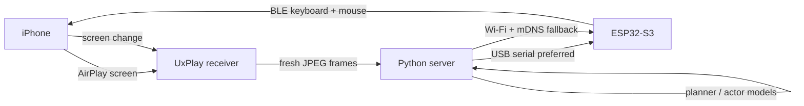

让 Agent 操作 iPhone，瓶颈通常不是模型，而是手。安卓有 ADB；iOS 常用的 WebDriverAgent 要开发者模式、Xcode 签名和证书维护，免费证书七天过期，别人的手机也很难按这套流程借给你测。

我换了一条路：<strong>ESP32-S3 只做标准蓝牙键盘和鼠标，AirPlay 把屏幕交给电脑，Python 服务端先看见指针、修正到位，再把点击交给手机。</strong>真机不越狱、不开开发者模式，也不安装被控 App。项目核心是给 Agent 一双合法外设的手，加一套可复核的眼睛，而不是攻破 iOS。

代码在 [hi-unc1e/esp32-iphone-agent](https://github.com/hi-unc1e/esp32-iphone-agent)。这次合并把「电脑控制模式」变成主线，同时保留原来板子自带 AirPlay、iPhone App 独立运行的版本。

## 闭环怎么成立

iOS 不需要知道自己被自动化。对它来说，ESP32-S3 就是一个叫 `iPhone Agent HID` 的蓝牙键鼠；打开 AssistiveTouch 后，鼠标移动变成屏幕指针移动，点击变成 tap，按住移动变成 swipe。



这条路有三个容易做错的地方，我都在代码里给了约束：

1. <strong>指针是相对的，iOS 还有加速度曲线。</strong>固件把移动拆成沿直线的等长报告，每 15 ms 一帧，避免发太快后被 BLE 合并或丢帧。服务端用三点自动校准拟合屏幕比例，之后定期把指针打回左上角清漂移。
2. <strong>不能盲点。</strong>AssistiveTouch 指针设成绿色小环后，服务端会在点击前识别指针；误差超过 0.8% 屏幕距离就修正，最多三次，仍然看不见或不到位就不按下。
3. <strong>动作后要复核。</strong>服务端等待新帧、确认画面变化，再把结果交给模型决定下一步。测试产物包含截图、动作坐标、OCR 断言、耗时和可选 MP4，而不是只留一句“成功”。

<figure>
  
  <figcaption>2026-10-31 当前 iPhone 实测：Agent 识别并点击 App Store 图标后截到的真实页面，绿色辅助触控指针仍在画面里。这里没有安装、购买或修改账号。</figcaption>
</figure>

下面这段 7.6 秒素材来自同一套链路，保留了原始录屏证据，方便看指针移动和界面反馈：

<video controls preload="metadata" playsinline style="width:100%;max-width:100%;height:auto;">
  <source src="/video/esp32-iphone-ble-hid-agent/demo.mp4" type="video/mp4">
  Your browser does not support embedded video.
</video>

## 关键架构改动

原项目的 standalone 架构很强硬：ESP32 自己做 AirPlay 接收器、开热点、转发 H.264，iPhone App 再通过 BLE 拿视频并决策。问题是 BLE 已经被视频占用，再叠 HID 会抢时序；Xcode 签名和 iOS App 也让借用设备变麻烦。

| 层 | 原主线 | 这次合并后的电脑控制模式 |
|---|---|---|
| 眼睛 | 板子接收 AirPlay，BLE 转视频 | Mac/Linux 跑 UxPlay，服务端读新鲜 JPEG |
| 大脑 | iPhone SwiftUI App | Python server，可接 planner/actor 视觉模型 |
| 手 | USB HID | ESP32-S3 BLE HID 键鼠 |
| 传输 | 手机和板子绑得更紧 | 有 USB 串口优先串口；拔线后 Wi-Fi/mDNS 自动找服务端 |
| 验收 | 人工看 App 状态 | JSON 场景、OCR、HTML 报告、截图和录屏 |

最有价值的改动不是“加了蓝牙”，而是把控制面从手机里拿出来。这样 Agent 可以和代码、日志、测试报告处在同一台电脑上，也能通过 CLI/MCP 把 iPhone 变成工具调用。板子仍然只执行行协议，不做决策；断线时会释放鼠标和键盘，避免卡在长按。

网络方向也反过来了：ESP32 主动连服务器，板上不开监听端口，手机热点 NAT 后面也能工作。`_hidagent._tcp` 由服务端广播，板子按 mDNS 找地址；插回 USB 时约 1 秒切到串口，拔掉供电重启后 8.3 秒经 Wi-Fi 回连，iPhone 蓝牙和投屏没有断。

## 实测边界

先说可用部分。2026-10-31 在当前 iPhone 上跑健康检查：

```json
{
  "server": true,
  "board": true,
  "bridge": "ok connected=1 encrypted=1 subscribed=0xe interval=15.00ms bonds=1",
  "bluetooth": true,
  "mirror": true,
  "calibrated": true
}
```

同一轮合并验收里：iOS 模拟器测试 81 个通过；Python 服务端 77 个通过、1 个跳过；BLE 固件和 standalone 固件都能编译。链路指标更能说明取舍：USB 串口路径 HTTP 到板子的 ping 中位数 5.0 ms、p95 5.4 ms；Wi-Fi 路径中位数 104 ms、p95 203 ms。所以默认推荐串口，无线只是脱机场景的兜底。

再说边界。iOS 不镜像锁屏密码、Apple Pay 和 DRM 视频；键盘报告目前以 ASCII 为主，中文要依赖输入法候选和额外点击，不能当成稳定通用输入；校准主要按竖屏设计；BLE HID 同一时间只连一个主机。物理 Agent 还会碰到购买、删除、发送这类不可逆按钮，测试场景必须先声明禁区，保留 Emergency Stop，并把录屏和结果 JSON 当成审计材料。

所以我的使用判断很直接：<strong>模拟器能证明的逻辑就留在模拟器；只有真实设备、真实网络、真实权限弹窗和真实传感器才值得用这套链路。</strong>它适合手机 App 回归、兼容性复现、红队报告里的“实际用户路径”证据，也适合行动受限时的远程手工控制。反过来说，如果你的目标是绕过 iOS 安全边界，这套方案并不适合：它只是用户已授权的辅助功能和外设自动化。

还有一个我在受限环境里看好的延伸：医院或隔离内网电脑装不了 Agent、访问不了外部服务时，能联网的手机可以承担交互入口，ESP32 再作为电脑的 HID 键盘，把手机侧文本敲进电脑。这个方向是 HID 架构的自然推论，当前仓库主线没有单独验收，先当实验分支，不要写成现成功能。

## 附录：复现与选购

<details>
<summary>硬件与软件清单</summary>

| 项 | 建议 | 原因 |
|---|---|---|
| 板子 | Seeed XIAO ESP32-S3，8 MB PSRAM / 8 MB Flash | 当前实测型号；带 Wi-Fi + BLE，固件 Flash 35%、RAM 26% |
| 天线 | 必装随板 U.FL 天线 | 不装时 RSSI 可到 -95 dBm，BLE 容易断 |
| 电源 | USB-C 数据线或充电头 | 插电脑时走串口；独立供电时走 Wi-Fi/mDNS |
| 网络 | 2.4 GHz Wi-Fi | ESP32 不支持 5 GHz；手机和电脑需能到达同一服务端 |
| 电脑 | macOS/Linux | 跑 UxPlay、Python server、模型和测试 |
| 软件 | ESP32 core 3.3.x，NimBLE-Arduino 2.5.1，UxPlay 1.74 | 版本偏差主要影响 HID API 和 GStreamer 兼容性 |
| 回退 | USB HID + Lightning 相机转换器 | BLE 不稳时保留有线方案，但要处理供电 |

</details>

<details>
<summary>最小复现路径</summary>

```bash
git clone https://github.com/hi-unc1e/esp32-iphone-agent.git
cd esp32-iphone-agent
arduino-cli lib install "NimBLE-Arduino@2.5.1"
hardware/flash_ble.sh --build-only

cd server
python3 -m venv .venv
.venv/bin/pip install -e .
cp .env.example .env
set -a && . ./.env && set +a
.venv/bin/python -m hidagent
```

iPhone 一次性设置：蓝牙配对 `iPhone Agent HID`；开启 AssistiveTouch，把指针设为绿色、最小尺寸、不自动隐藏；开启屏幕镜像到 `iPhone Agent`；在 Web 控制台执行校准。之后先用时钟、地图搜索、App Store 浏览这类无害场景验证，不要直接上账号、支付和删除操作。

</details>

真机 Agent 的价值不在于替代 ADB，而在于当 ADB、越狱和开发者模式都不可用时，仍然能留下一段可重放、可审计、可失败的动作证据。
