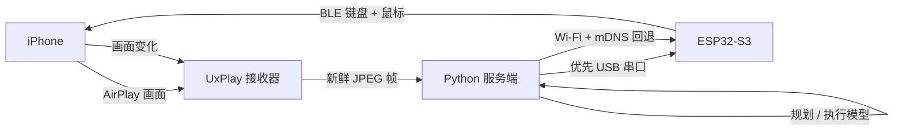

让 Agent 操作 iPhone，最麻烦的地方通常不是模型，而是手。安卓有 ADB；iOS 上的 WebDriverAgent 要开发者模式、Xcode 签名和证书维护，免费证书七天就过期，别人的手机也不方便这样折腾。

我换了个办法：ESP32-S3 只做标准蓝牙键鼠，AirPlay 把画面送到电脑，Python 服务端看着屏幕移动指针，校准到位后再点击。手机端不用越狱，也不用装被控 App。

代码在 [hi-unc1e/esp32-iphone-agent](https://github.com/hi-unc1e/esp32-iphone-agent)。主线已经改成电脑控制模式，原来板子独立接 AirPlay、iPhone App 自己跑的那套还留着。

## 它怎么跑起来

iOS 只知道多了一个叫 `iPhone Agent HID` 的蓝牙键鼠。打开 AssistiveTouch 后，鼠标移动对应指针移动，点击就是 tap，按住拖动就是 swipe。



链路要稳，主要是三件事。

先是指针会漂。iOS 的鼠标移动是相对坐标，还带加速度。固件把每次移动拆成等长报告，每 15 ms 发一帧，免得 BLE 把中间帧合掉。服务端用三点校准拟合屏幕比例，再定期把指针拉回左上角。

然后是点击前的确认。AssistiveTouch 指针设成绿色小环，服务端先找到它再点。误差超过屏幕距离的 0.8% 就修正，最多三次；还不对就不点。

点完也不能马上算成功。服务端等下一帧，看见画面变化再把结果交给模型。每次动作的截图、坐标和耗时都会留下，失败时能倒回去看。

<figure>
  
  <figcaption>Agent 点开 App Store 后截下的画面，绿色指针还在。</figcaption>
</figure>

这段 7.6 秒录屏能看到指针怎么移动、界面怎么响应：

<video controls preload="metadata" playsinline style="width:100%;max-width:100%;height:auto;">
  <source src="/video/esp32-iphone-ble-hid-agent/demo.mp4" type="video/mp4">
  你的浏览器不支持内嵌视频。
</video>

## 为什么把决策放到电脑

原项目让 ESP32 自己接 AirPlay、开热点、转 H.264，iPhone App 再通过 BLE 拿视频做决策。视频本身已经吃满 BLE，再塞 HID 就容易抢时序；借手机测试还得处理 Xcode 签名。

现在 Mac/Linux 负责看画面、跑模型、记日志和跑测试，ESP32 只管键鼠动作。断线时它会松开鼠标和键盘，不会卡在长按。

网络也换了个方向：ESP32 主动找服务端，板上不监听端口。插着 USB 就走串口，拔线后靠 Wi-Fi + mDNS 自动回连；手机开热点、做 NAT 也能用。

## 实测下来

这套东西已经在手边的 iPhone 上跑通：配对、投屏、校准、点击都能走完。

USB 到板子的 ping 中位数是 5 ms，Wi-Fi 是 104 ms。能用线就用线，Wi-Fi 留给不方便插电脑的时候。

键盘报告目前以 ASCII 为主，中文要靠输入法候选和额外点击。校准也主要按竖屏做，一个 BLE HID 同时只能连一个主机。

能放模拟器里测的逻辑，就别占真机。真机留给网络、权限弹窗、传感器这些模拟器替代不了的东西。我平时用它跑 App 回归和兼容性复现，也会在红队报告里补几张真机截图。

医院里更麻烦：电脑不能装 Agent，也上不了外网，就让手机跑 AI，ESP32 把手机上的文字当成键盘输入敲进电脑。这个用法我还没写，感兴趣可以往这个方向深挖。

它替代不了模拟器。需要碰真机的时候，再让它上场。

## 附录：复现与选购

<details>
<summary>硬件怎么选</summary>

我用的是 Seeed XIAO ESP32-S3，8 MB PSRAM / 8 MB Flash。随板 U.FL 天线一定要装，不装时 RSSI 会掉到 -95 dBm。它只支持 2.4 GHz Wi-Fi；电脑用 macOS/Linux 跑 UxPlay、Python 服务端和模型。插电脑时用 USB-C 数据线供电，单独用时接充电头。

我这边跑的是 ESP32 core 3.3.x、NimBLE-Arduino 2.5.1 和 UxPlay 1.74。BLE 不稳就换 USB HID + Lightning 相机转换器；如果提示“配件耗电过大”，给转换器接上充电头。

</details>

<details>
<summary>从零跑一遍</summary>

```bash
git clone https://github.com/hi-unc1e/esp32-iphone-agent.git
cd esp32-iphone-agent
arduino-cli lib install "NimBLE-Arduino@2.5.1"
hardware/flash_ble.sh --build-only

cd server
python3 -m venv .venv
.venv/bin/pip install -e .
cp .env.example .env
set -a && . ./.env && set +a
.venv/bin/python -m hidagent
```

iPhone 只需设置一次：蓝牙配对 `iPhone Agent HID`；打开 AssistiveTouch，把指针设为绿色、最小尺寸、不自动隐藏；打开屏幕镜像到 `iPhone Agent`；在 Web 控制台校准。之后用时钟、地图搜索和 App Store 浏览检查链路。

</details>
